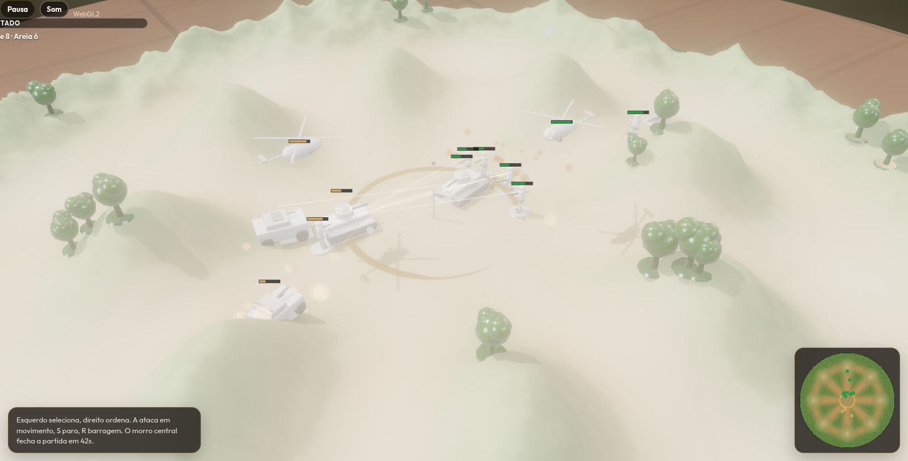

# Soldadinhos

Batalha tática 1v1 de soldadinhos de plástico no navegador. O mapa é um círculo com relevo, o exército cabe num orçamento, e a partida se decide no morro do centro ou quando não sobra combatente.

## Como rodar

```bash
npm install
npm run dev
```

Abre `http://127.0.0.1:5173`. Atalho de demonstração, já no meio de uma batalha: `http://127.0.0.1:5173/?demo=1`.

```bash
npm test        # simulação determinística
npm run build   # tsc + vite
npm run preview
```

## Como jogar

1. **Contra a IA** ou **dois no mesmo teclado**. No hot-seat, cada jogador monta o exército e escolhe o posto sem o outro olhar; `Tab` troca o controle na batalha.
2. **Exército.** 132 fichas. Exatamente um helicóptero e um caça. Limites: 18 de infantaria, 2 viaturas, 2 tanques, 2 armas pesadas, 4 posições. Listas prontas ficam no topo.
3. **Posto.** Oito anéis no círculo. Trincheira, sacos, obuseiro, Igla e ninhos são cravados à mão, ou entram na disposição automática.
4. **Batalha.** Esquerdo seleciona (e arrasta uma caixa). Direito anda, ou atira no chão se a peça for jato, morteiro, obuseiro ou posição fixa. `Shift` + direito força a marcha de uma arma indireta. `A` arma ataque em movimento, `S` para, `R` arma a barragem do rádio. `1`–`9` chamam grupos, `Ctrl`+número grava. Setas, `W`/`D`, bordas da tela, botão do meio e a roda mexem na câmera. `Q`/`E` giram. `P` ou espaço pausa.
5. **Vitória.** Eliminar os combatentes inimigos, ou segurar o morro central por 42 segundos com infantaria, viatura ou tanque. Aéreo não captura. Trincheira e sacos não mantêm ninguém na partida sozinhos.

O morro alto dá vantagem de tiro. Trincheira e sacos dão cobertura. Tiro indireto ignora a linha de visão e sofre menos com cobertura. A névoa esconde unidades, não o tabuleiro; um contato some de vista e deixa um fantasma por alguns segundos.

## Stack

Prioridade: imagem de plástico sob luz de mesa, e uma simulação que no futuro possa rodar igual nos dois clientes.

| Peça | Escolha | Por quê |
|---|---|---|
| App | Vite 7 + TypeScript, sem React | O laço de render e de simulação é um quadro só. A interface é DOM por cima do canvas, e não precisa de uma árvore virtual no meio. |
| 3D | three.js r186 `WebGPURenderer` + TSL | WebGPU quando o navegador tem; o mesmo renderer cai para WebGL2 sozinho. SSAO e bloom saem de um `RenderPipeline` (o nome novo do antigo post-processing). Instâncias de GPU, uma malha por tipo de peça, material físico com clearcoat para o plástico. |
| Simulação | Mundo próprio, tick fixo de 20 Hz, dentro de um Web Worker | O worker é o anfitrião local. A thread principal só desenha e manda comandos. Não há `Math.random` no tick: o terreno e os tiros saem de um mulberry32 e de hashes inteiros. |
| Física | Nenhuma (Rapier/Jolt ficaram de fora) | WASM de física não é determinístico entre CPUs, e um lockstep precisa do mesmo resultado dos dois lados. Separação em círculo e altura do terreno resolvem o que o jogo pede. |
| ECS | Nenhum (bitecs/miniplex ficaram de fora) | O estado é um array de unidades com id estável. Um ECS genérico não deixa o hash de lockstep mais claro, e esconde a ordem de iteração. |
| Rede | Protocolo em `src/net/protocol.ts`, sem transporte ainda | O contrato já é o de lockstep: semente, listas de spawn e comandos com tick atrasado (`INPUT_DELAY_TICKS`). Colyseus ou um host WebRTC só retransmitem isso e comparam `Snapshot.hash`. |

A IA roda dentro da simulação, não na interface, para os dois pares reproduzirem as mesmas ordens. Comandos humanos entram dois ticks à frente.

## Arquitetura

- `src/data/catalog.ts` — definições das peças, custos, armas, listas prontas.
- `src/sim` — terreno, caminho A*, mundo, IA, deploy, worker.
- `src/render` — malhas procedurais e a vista (instâncias, sombras, SSAO, bloom).
- `src/app.ts` — fluxo menu → exército → posto → batalha.
- `src/net/protocol.ts` — o que um futuro servidor precisa concordar.

O hash da partida mistura tick, vencedor, estado do gerador e posições/vida quantizadas. Dois mundos com a mesma semente e os mesmos comandos têm de bater; `npm test` cobre isso.

## Roteiro

- Sala Colyseus ou host WebRTC em lockstep, com pedido de snapshot se o hash divergir.
- Replay a partir do log de comandos (a semente e a fila já bastam).
- Peças em glTF no lugar das malhas procedurais, quando o silhueta pedir mais leitura.
- Mais listas, um modo campanha curto, e som além dos blips atuais.


